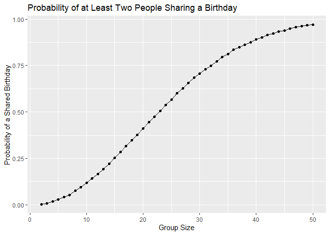
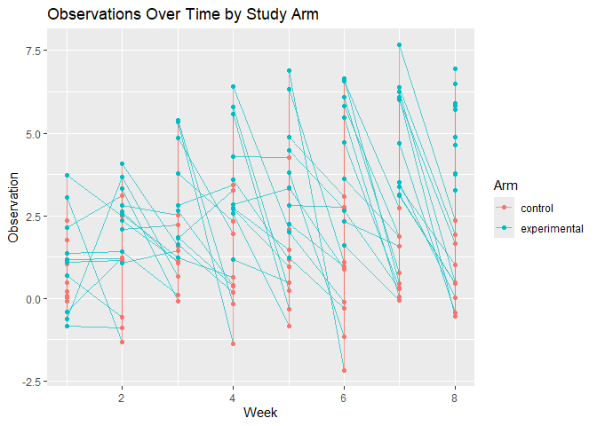
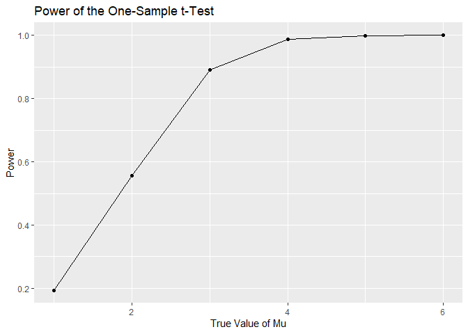
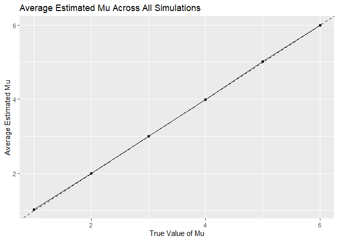
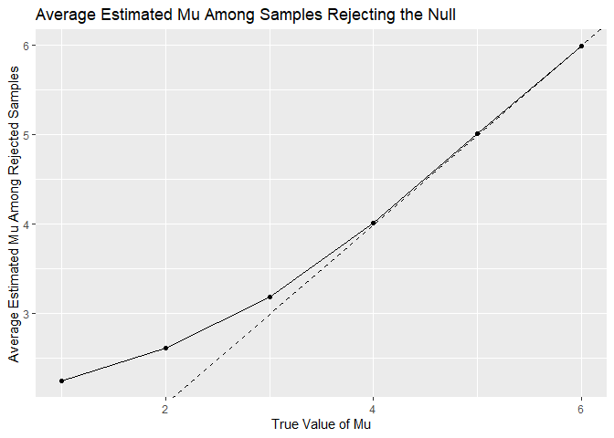

Homework 5
================
Jiaqi Xie
2026-11-19

# Problem 1

``` r
birthday_check = function(n) {
  birthdays = sample(1:365, size = n, replace = TRUE)
  any(duplicated(birthdays))
}
```

``` r
birthday_sim =
  tibble(group_size = 2:50) |>
  mutate(
    probability = map_dbl(
      group_size,
      \(n) mean(replicate(10000, birthday_check(n)))
    )
  )
```

``` r
birthday_sim |>
  ggplot(aes(x = group_size, y = probability)) +
  geom_line() +
  geom_point() +
  labs(
    x = "Group Size",
    y = "Probability of a Shared Birthday",
    title = "Probability of at Least Two People Sharing a Birthday"
  )
```

<!-- -->

# Problem 2

``` r
study_files =
  list.files(
    path = "data",
    pattern = "\\.csv$",
    full.names = TRUE
  )

study_files
```

    ## character(0)

``` r
study_data =
  study_files |>
  map_dfr(
    \(file) read_csv(file, show_col_types = FALSE) |>
      mutate(file_name = basename(file))
  )

study_data
```

    ## # A tibble: 0 × 0

``` r
study_files =
  list.files(
    path = "data",
    pattern = "\\.csv$",
    full.names = TRUE,
    recursive = TRUE
  )

study_files
```

    ##  [1] "data/data/con_01.csv" "data/data/con_02.csv" "data/data/con_03.csv"
    ##  [4] "data/data/con_04.csv" "data/data/con_05.csv" "data/data/con_06.csv"
    ##  [7] "data/data/con_07.csv" "data/data/con_08.csv" "data/data/con_09.csv"
    ## [10] "data/data/con_10.csv" "data/data/exp_01.csv" "data/data/exp_02.csv"
    ## [13] "data/data/exp_03.csv" "data/data/exp_04.csv" "data/data/exp_05.csv"
    ## [16] "data/data/exp_06.csv" "data/data/exp_07.csv" "data/data/exp_08.csv"
    ## [19] "data/data/exp_09.csv" "data/data/exp_10.csv"

``` r
study_data =
  study_files |>
  map_dfr(
    \(file) read_csv(file, show_col_types = FALSE) |>
      mutate(file_name = basename(file))
  )

study_data
```

    ## # A tibble: 20 × 9
    ##    week_1 week_2 week_3 week_4 week_5 week_6 week_7 week_8 file_name 
    ##     <dbl>  <dbl>  <dbl>  <dbl>  <dbl>  <dbl>  <dbl>  <dbl> <chr>     
    ##  1   0.2   -1.31   0.66   1.96   0.23   1.09   0.05   1.94 con_01.csv
    ##  2   1.13  -0.88   1.07   0.17  -0.83  -0.31   1.58   0.44 con_02.csv
    ##  3   1.77   3.11   2.22   3.26   3.31   0.89   1.88   1.01 con_03.csv
    ##  4   1.04   3.66   1.22   2.33   1.47   2.7    1.87   1.66 con_04.csv
    ##  5   0.47  -0.58  -0.09  -1.37  -0.32  -2.17   0.45   0.48 con_05.csv
    ##  6   2.37   2.5    1.59  -0.16   2.08   3.07   0.78   2.35 con_06.csv
    ##  7   0.03   1.21   1.13   0.64   0.49  -0.12  -0.07   0.46 con_07.csv
    ##  8  -0.08   1.42   0.09   0.36   1.18  -1.16   0.33  -0.44 con_08.csv
    ##  9   0.08   1.24   1.44   0.41   0.95   2.75   0.3    0.03 con_09.csv
    ## 10   2.14   1.15   2.52   3.44   4.26   0.97   2.73  -0.53 con_10.csv
    ## 11   3.05   3.67   4.84   5.8    6.33   5.46   6.38   5.91 exp_01.csv
    ## 12  -0.84   2.63   1.64   2.58   1.24   2.32   3.11   3.78 exp_02.csv
    ## 13   2.15   2.08   1.82   2.84   3.36   3.61   3.37   3.74 exp_03.csv
    ## 14  -0.62   2.54   3.78   2.73   4.49   5.82   6      6.49 exp_04.csv
    ## 15   0.7    3.33   5.34   5.57   6.9    6.66   6.24   6.95 exp_05.csv
    ## 16   3.73   4.08   5.4    6.41   4.87   6.09   7.66   5.83 exp_06.csv
    ## 17   1.18   2.35   1.23   1.17   2.02   1.61   3.13   4.88 exp_07.csv
    ## 18   1.37   1.43   1.84   3.6    3.8    4.72   4.68   5.7  exp_08.csv
    ## 19  -0.4    1.08   2.66   2.7    2.8    2.64   3.51   3.27 exp_09.csv
    ## 20   1.09   2.8    2.8    4.3    2.25   6.57   6.09   4.64 exp_10.csv

``` r
study_tidy =
  study_data |>
  mutate(
    arm = case_when(
      str_detect(file_name, "^con") ~ "control",
      str_detect(file_name, "^exp") ~ "experimental"
    ),
    subject_id = str_extract(file_name, "\\d+")
  ) |>
  pivot_longer(
    week_1:week_8,
    names_to = "week",
    values_to = "observation"
  ) |>
  mutate(
    week = as.integer(str_remove(week, "week_"))
  ) |>
  select(subject_id, arm, week, observation)

study_tidy
```

    ## # A tibble: 160 × 4
    ##    subject_id arm      week observation
    ##    <chr>      <chr>   <int>       <dbl>
    ##  1 01         control     1        0.2 
    ##  2 01         control     2       -1.31
    ##  3 01         control     3        0.66
    ##  4 01         control     4        1.96
    ##  5 01         control     5        0.23
    ##  6 01         control     6        1.09
    ##  7 01         control     7        0.05
    ##  8 01         control     8        1.94
    ##  9 02         control     1        1.13
    ## 10 02         control     2       -0.88
    ## # ℹ 150 more rows

``` r
study_tidy |>
  ggplot(
    aes(
      x = week,
      y = observation,
      group = subject_id,
      color = arm
    )
  ) +
  geom_line(alpha = 0.7) +
  geom_point() +
  labs(
    x = "Week",
    y = "Observation",
    color = "Arm",
    title = "Observations Over Time by Study Arm"
  )
```

<!-- -->

Participants in the experimental arm generally show an increasing
pattern in observations over time, while observations in the control arm
appear more stable. This suggests a possible difference in longitudinal
trends between the two study groups.

# Problem 3

``` r
sim_t_test = function(mu) {
  sample_data =
    tibble(
      x = rnorm(n = 30, mean = mu, sd = 5)
    )

  test_result =
    t.test(sample_data$x, mu = 0) |>
    broom::tidy()

  tibble(
    mu_hat = mean(sample_data$x),
    p_value = test_result$p.value
  )
}
```

``` r
sim_results_mu0 =
  rerun(5000, sim_t_test(mu = 0)) |>
  bind_rows()
```

    ## Warning: `rerun()` was deprecated in purrr 1.0.0.
    ## ℹ Please use `map()` instead.
    ##   # Previously
    ##   rerun(5000, sim_t_test(mu = 0))
    ## 
    ##   # Now
    ##   map(1:5000, ~ sim_t_test(mu = 0))
    ## This warning is displayed once per session.
    ## Call `lifecycle::last_lifecycle_warnings()` to see where this warning was
    ## generated.

``` r
sim_results_mu0
```

    ## # A tibble: 5,000 × 2
    ##     mu_hat p_value
    ##      <dbl>   <dbl>
    ##  1 -1.86    0.0759
    ##  2  0.853   0.425 
    ##  3  0.0449  0.960 
    ##  4 -1.41    0.181 
    ##  5  1.94    0.0449
    ##  6 -0.712   0.462 
    ##  7  0.169   0.894 
    ##  8 -0.539   0.590 
    ##  9 -0.364   0.645 
    ## 10  0.417   0.631 
    ## # ℹ 4,990 more rows

``` r
sim_results =
  tibble(mu = 1:6) |>
  mutate(
    output = map(
      mu,
      \(mu_value) rerun(5000, sim_t_test(mu = mu_value)) |>
        bind_rows()
    )
  ) |>
  unnest(output)
```

    ## Warning: There was 1 warning in `mutate()`.
    ## ℹ In argument: `output = map(mu, function(mu_value) bind_rows(rerun(5000,
    ##   sim_t_test(mu = mu_value))))`.
    ## Caused by warning:
    ## ! `rerun()` was deprecated in purrr 1.0.0.
    ## ℹ Please use `map()` instead.
    ##   # Previously
    ##   rerun(5000, sim_t_test(mu = mu_value))
    ## 
    ##   # Now
    ##   map(1:5000, ~ sim_t_test(mu = mu_value))

``` r
sim_results
```

    ## # A tibble: 30,000 × 3
    ##       mu mu_hat p_value
    ##    <int>  <dbl>   <dbl>
    ##  1     1  0.857  0.362 
    ##  2     1  1.82   0.103 
    ##  3     1  0.247  0.794 
    ##  4     1  1.07   0.124 
    ##  5     1  1.40   0.0430
    ##  6     1  0.806  0.395 
    ##  7     1  0.196  0.821 
    ##  8     1  0.868  0.336 
    ##  9     1  0.579  0.622 
    ## 10     1  1.29   0.128 
    ## # ℹ 29,990 more rows

``` r
power_results =
  sim_results |>
  mutate(
    reject = p_value < 0.05
  ) |>
  group_by(mu) |>
  summarize(
    power = mean(reject),
    .groups = "drop"
  )

power_results
```

    ## # A tibble: 6 × 2
    ##      mu power
    ##   <int> <dbl>
    ## 1     1 0.194
    ## 2     2 0.556
    ## 3     3 0.890
    ## 4     4 0.989
    ## 5     5 1.000
    ## 6     6 1

``` r
power_results |>
  ggplot(aes(x = mu, y = power)) +
  geom_line() +
  geom_point() +
  labs(
    x = "True Value of Mu",
    y = "Power",
    title = "Power of the One-Sample t-Test"
  )
```

<!-- -->

``` r
mean_estimates =
  sim_results |>
  group_by(mu) |>
  summarize(
    mean_mu_hat = mean(mu_hat),
    .groups = "drop"
  )

mean_estimates
```

    ## # A tibble: 6 × 2
    ##      mu mean_mu_hat
    ##   <int>       <dbl>
    ## 1     1        1.03
    ## 2     2        2.00
    ## 3     3        3.00
    ## 4     4        3.99
    ## 5     5        5.01
    ## 6     6        5.99

``` r
mean_estimates |>
  ggplot(aes(x = mu, y = mean_mu_hat)) +
  geom_line() +
  geom_point() +
  geom_abline(intercept = 0, slope = 1, linetype = "dashed") +
  labs(
    x = "True Value of Mu",
    y = "Average Estimated Mu",
    title = "Average Estimated Mu Across All Simulations"
  )
```

<!-- -->

``` r
rejected_estimates =
  sim_results |>
  filter(p_value < 0.05) |>
  group_by(mu) |>
  summarize(
    mean_mu_hat_rejected = mean(mu_hat),
    .groups = "drop"
  )

rejected_estimates
```

    ## # A tibble: 6 × 2
    ##      mu mean_mu_hat_rejected
    ##   <int>                <dbl>
    ## 1     1                 2.25
    ## 2     2                 2.62
    ## 3     3                 3.18
    ## 4     4                 4.01
    ## 5     5                 5.01
    ## 6     6                 5.99

``` r
rejected_estimates |>
  ggplot(aes(x = mu, y = mean_mu_hat_rejected)) +
  geom_line() +
  geom_point() +
  geom_abline(intercept = 0, slope = 1, linetype = "dashed") +
  labs(
    x = "True Value of Mu",
    y = "Average Estimated Mu Among Rejected Samples",
    title = "Average Estimated Mu Among Samples Rejecting the Null"
  )
```

<!-- -->

The average estimate of mu across all simulated datasets is
approximately equal to the true value of mu. However, among datasets for
which the null hypothesis is rejected, the average estimate can be
farther from 0 than the true value, especially when the true effect is
small. This occurs because samples with more extreme estimated means are
more likely to produce small p-values and reject the null hypothesis.
